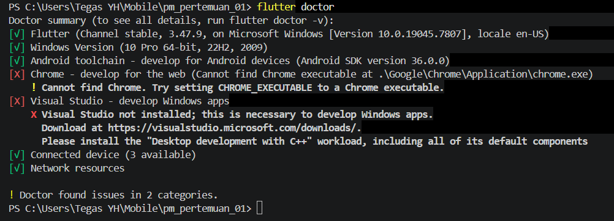
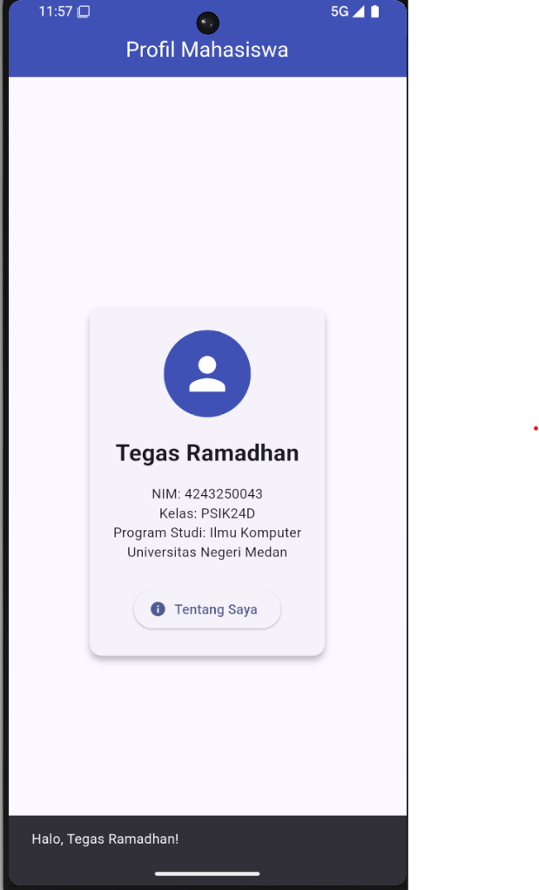

# Tugas Rutin 1 – Pemrograman Mobile

## Profil Mahasiswa

### Identitas
- **Nama:** Tegas Ramadhan
- **NIM:** 4243250043
- **Kelas:** PSIK24D
- **Program Studi:** Ilmu Komputer
- **Universitas:** Universitas Negeri Medan

## Deskripsi Proyek

Aplikasi ini merupakan aplikasi sederhana berbasis Flutter yang dibuat untuk memenuhi Tugas Rutin 1 mata kuliah Pemrograman Mobile.

Aplikasi menampilkan informasi profil mahasiswa dengan beberapa komponen antarmuka, yaitu:
- Nama lengkap mahasiswa.
- Nomor Induk Mahasiswa (NIM).
- Kelas dan program studi.
- Nama universitas.
- Ikon profil menggunakan CircleAvatar.
- Tombol interaktif menggunakan ElevatedButton yang menampilkan pesan SnackBar.

## Teknologi yang Digunakan

- Flutter 3.47.9
- Dart 3.13.7
- Android Studio
- Visual Studio Code
- Android Emulator Pixel 6
- Android 16 (API 36)

## Versi Flutter

Hasil pemeriksaan versi Flutter:

```text
Flutter 3.47.9 • channel stable
Dart 3.13.7
DevTools 2.60.0
```

## Hasil Flutter Doctor

Berikut merupakan hasil pemeriksaan konfigurasi Flutter pada perangkat.



Catatan: Chrome dan Visual Studio belum terpasang. Keduanya tidak diperlukan untuk menjalankan aplikasi Android pada tugas ini.

## Tampilan Aplikasi

Berikut merupakan hasil implementasi aplikasi profil mahasiswa yang berhasil dijalankan menggunakan Android Emulator.



## Kendala dan Solusi

### 1. Android NDK Tidak Ditemukan

**Kendala:** Proses build mengalami kegagalan karena Android NDK versi 28.2.13676358 belum tersedia pada Android SDK.

**Solusi:** Memasang Android NDK versi 28.2.13676358 melalui Android Studio SDK Manager.

### 2. Gagal Memasang APK ke Emulator

**Kendala:** Proses instalasi APK mengalami error `Broken pipe (32)` akibat gangguan komunikasi antara ADB dan emulator.

**Solusi:** Melakukan restart ADB menggunakan perintah `adb kill-server` dan `adb start-server`, kemudian menjalankan kembali emulator.

## Perbandingan Native, Hybrid, dan Cross-Platform

Pengembangan aplikasi mobile memiliki beberapa pendekatan, yaitu Native, Hybrid, dan Cross-Platform. Ketiganya memiliki karakteristik dan keunggulan masing-masing.

**1. Native**

Native merupakan metode pengembangan aplikasi yang dibuat khusus untuk satu sistem operasi. Android umumnya menggunakan Kotlin atau Java, sedangkan iOS menggunakan Swift. Keunggulannya adalah performa yang optimal dan akses langsung ke fitur perangkat. Contoh penerapannya adalah aplikasi kamera yang membutuhkan akses mendalam terhadap perangkat.

**2. Hybrid**

Hybrid merupakan pendekatan pengembangan aplikasi yang menggabungkan teknologi web seperti HTML, CSS, dan JavaScript ke dalam aplikasi mobile. Aplikasi dikemas menggunakan komponen khusus agar dapat dijalankan pada perangkat mobile. Pendekatan ini cocok untuk aplikasi katalog produk atau aplikasi informasi perusahaan yang memiliki kebutuhan relatif sederhana.

**3. Cross-Platform**

Cross-Platform memungkinkan pengembang membuat aplikasi untuk beberapa sistem operasi menggunakan satu basis kode. Salah satu contohnya adalah Flutter yang menggunakan bahasa Dart. Pendekatan ini dapat menghemat waktu pengembangan dan mempermudah pemeliharaan aplikasi. Contoh penerapannya adalah aplikasi pendidikan, layanan publik, dan pemesanan online.

Dari ketiga pendekatan tersebut, pemilihan metode pengembangan harus disesuaikan dengan kebutuhan aplikasi, target pengguna, biaya, serta performa yang diharapkan.

## Pernyataan Penggunaan AI

AI digunakan sebagai alat bantu untuk memahami penggunaan Flutter, membantu mengatasi kendala teknis, serta memberikan arahan dalam penyusunan dokumentasi. Implementasi dan pengujian aplikasi dilakukan secara langsung oleh mahasiswa.

---

**Universitas Negeri Medan**  
**Program Studi Ilmu Komputer**  
**2026**